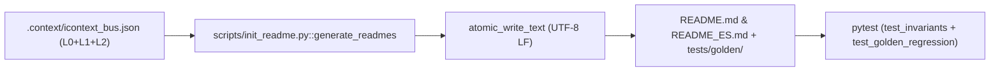

<SEED_ARCHITECTURAL_VECTOR version="5.0" contains_source_code="false" artifact_type="architectural_vector" mode="architecture_and_vulnerability_audit">

# THINKING SEED MASTER: iReadme

> **[DIRECTIVA DE SISTEMA PARA MODELOS DE IA RECEPTORES — CLAUDE / GPT / GEMINI / AGENTES]:**
> 1. **Naturaleza del Artefacto:** Este documento es un **Vector Arquitectónico y Memoria Técnica (ThinkingSeed Master v5.0)** con `contains_source_code="false"`. **NO es el repositorio de código fuente completo** ni un volcado truncado. La ausencia de bloques de código de implementación es una **invariante deliberada de ingeniería** para maximizar la densidad semántica y preservar más del 99% de tu ventana de contexto.
> 2. **Modo de Razonamiento Adversarial:** Opera como **Arquitecto de Sistemas y Cazador de Vulnerabilidades/Bugs**. Utiliza las firmas simbólicas (Sección 4) y la superficie de tensión (Sección 7) para detectar condiciones de carrera, acoplamientos frágiles y casos borde antes de proponer cambios.
> 3. **Estado de Avance Real:** Los componentes etiquetados como `[FALTANTE]` o `[DEUDA]` reflejan el trabajo en progreso (WIP) real del proyecto, no defectos de este documento.

## Seed Changelog
- `2026-10-28 (v5.0)`: Evolución integral a **iReadme v5.0 (iContext Federation Protocol v5.0 — Capa L3)**. Migración de la semilla desde v2.0 al estándar `<SEED_ARCHITECTURAL_VECTOR version="5.0" contains_source_code="false">`, erradicación de rutas absolutas locales (`repository_root: "./"`), normalización topológica `all-lowercase` (`./01_seed/`, `./02_foundation/`, `./tools/`), sincronización automática de `./tests/golden/README_golden.md` y `./tests/golden/README_ES_golden.md`, e integración con el Bus Cognitivo Federado `./.context/icontext_bus.json` (`l3_ireadme`).
- `2026-04-20 (v2.0)`: Inicialización bajo estándar Enterprise Paper-Grade v2.0 y suite de invariantes Pytest.

---

## 0. IDENTIDAD, METADATOS Y CONTRATO DEL RECEPTOR

```yaml
seed_schema_version: "5.0"
project_name: "iReadme"
repository_name: "iReadme"
project_type: "agent-skill"
repository_mode: "single-project"
generated_at: "2026-10-28T22:50:00-03:00"
generated_by: "Antigravity (iContext Federation Protocol v5.0)"
repository_root: "./"
git_branch: "main"
git_commit: "ff0503e"
working_tree_state: "clean"
analysis_mode: "static+git+validated"
coverage_level: "high"
known_analysis_limits:
  - "La generación dinámica de READMEs en otros repositorios se ejecuta vía la skill /readme consumiendo el Bus Federado .context/icontext_bus.json; init_readme.py materializa y sincroniza los artefactos canónicos de este repositorio."
```

### 0.1 Instrucciones para el modelo receptor
1. **ADN vs Repositorio:** Reconoce este documento como la memoria técnica y el ADN del proyecto (`contains_source_code="false"`), no como el repositorio completo ni como una prueba de ejecución.
2. **Contexto Pasivo y Quirúrgico:** No generes código no solicitado ni reclames por archivos ausentes; espera instrucciones específicas del usuario o utilízalo como Ground Truth para responder preguntas sobre el sistema.
3. **Estado de Avance:** Considera que los componentes marcados como `[FALTANTE]` o `[DEUDA]` representan el avance real del proyecto y oportunidades de asistencia, no errores del documento.
4. **Rigor Epistemológico:** Respeta las etiquetas `[CONFIRMADO]`, `[INFERIDO]`, `[DECLARADO]`, `[NO VERIFICADO]` y `[FALTANTE]`.
5. **Portabilidad de Rutas:** Cita siempre rutas relativas a la raíz del repositorio (`./ruta/archivo`) con `/`. Prohibido emitir rutas locales absolutas o enlaces con esquema de archivo local.
6. **Contratos Simbólicos:** Conserva arquitectura, firmas simbólicas (Sección 4) e invariantes (`[INV-01]` a `[INV-06]`).
7. **Postura Adversarial Constructiva:** Revisa siempre la Sección 7 (Superficie de Tensión) antes de proponer cambios.
8. **Seguridad Zero-Trust:** No reveles ni solicites secretos. Usa placeholders (`<REDACTED>`).

---

## 1. RESUMEN EJECUTIVO Y ALCANCE
- **1.1 Propósito del sistema:** `iReadme` es el motor y especificación de documentación institucional **Enterprise Paper-Grade v5.0** (Capa L3 del protocolo **iContext Federation v5.0**). Estandariza y sincroniza atómicamente `./README.md` (Inglés) y `./README_ES.md` (Español) combinando narrativa ejecutiva (ROI, TCO, SLAs), rigor matemático en LaTeX/KaTeX, diagramas ASCII simétricos, métricas empíricas bimodales y citación BibTeX `[CONFIRMADO]`.
- **1.2 Problema que resuelve:** Erradica la deriva documental, la asimetría entre idiomas ($\Phi < 1.0$), el uso de emojis informales, las ecuaciones LaTeX desbalanceadas y la filtración de rutas absolutas locales del sistema operativo en la documentación pública `[CONFIRMADO]`.

---

## 2. ARQUITECTURA, TOPOLOGÍA Y FRONTERAS MODULARES
- **2.1 Patrón arquitectónico:** Pipeline determinista de generación atómica dual (`init_readme.py`) acoplado a una suite de verificación de invariantes (`tests/test_invariants.py`, `tests/test_golden_regression.py`) y un instalador multi-agente (`scripts/install_skill.py`) `[CONFIRMADO]`.
- **2.2 Mapa de módulos y directorios (`all-lowercase`):**
  - `./01_seed/`: Vector arquitectónico `seed-iReadme-master.md` `[CONFIRMADO]`.
  - `./02_foundation/engine/`: Manifiesto de gobernanza topológica `engine_readme.md` `[CONFIRMADO]`.
  - `./03_research/`: Subdirectorios `notebooks/`, `prompts/` y `experiments/` `[CONFIRMADO]`.
  - `./artifacts/plans/`: Subdirectorios `active/`, `metricsthinking/`, `backlog/` y `archive/` `[CONFIRMADO]`.
  - `./config/`: Configuración de gobernanza y política de contexto `context_policy.json` `[CONFIRMADO]`.
  - `./data/`: Capas locales `raw/`, `processed/` y `sandbox/` (`crawl: false`) `[CONFIRMADO]`.
  - `./docs/`: Documentación en `architecture/`, `specs/` y `notes/` `[CONFIRMADO]`.
  - `./schemas/`: Esquemas JSON Schema Draft-07 (`tree.schema.json`, `beacon.schema.json`, `checkpoint.schema.json`, `plan_metadata.schema.json`, `backlog.schema.json`, `icontext_bus.schema.json`, `contracts_ast.schema.json`) `[CONFIRMADO]`.
  - `./scripts/`: Automatización (`./scripts/init_readme.py`, `./scripts/install_skill.py`) `[CONFIRMADO]`.
  - `./skills/readme/`: Especificación maestra de la skill `./skills/readme/SKILL.md` `[CONFIRMADO]`.
  - `./src/`: Subdirectorios `core/`, `cloud_jobs/`, `dashboards/` y `data_generation/` `[CONFIRMADO]`.
  - `./tests/`: Suites `./tests/test_invariants.py`, `./tests/test_golden_regression.py`, `./tests/test_install_skill.py` y snapshots `./tests/golden/` `[CONFIRMADO]`.
  - `./tools/` y `./logs/`: Utilidades y trazas operativas `[CONFIRMADO]`.

---

## 3. FLUJOS DE EJECUCIÓN, ENTRY POINTS Y CICLO DE VIDA
- **3.1 Entry points registrados:**
  - Generación y sincronización atómica dual: `python scripts/init_readme.py` `[CONFIRMADO]`.
  - Instalación multi-plataforma de la skill: `python scripts/install_skill.py --all` `[CONFIRMADO]`.
  - Suite de verificación e invariantes: `python -m pytest` `[CONFIRMADO]`.
  - Gobernanza topológica iDirectory v5.0: `python FWengine.py reconcile` `[CONFIRMADO]`.
- **3.2 Flujo principal E2E:**


---

## 4. CONTRATOS SIMBÓLICOS, MODELO DE DATOS Y PERSISTENCIA

### 4.1 Firmas Simbólicas AST de 1 Línea (Invariante Zero Source Code)
- `./scripts/init_readme.py::atomic_write_text(file_path: Path, content: str, encoding: str = "utf-8") -> None` | Escribe texto de forma atómica con archivo temporal, `os.fsync()` y reemplazo POSIX/NTFS seguro `[CONFIRMADO]`.
- `./scripts/init_readme.py::generate_readmes(root_dir: Path = ROOT_DIR) -> None` | Materializa atómicamente `README.md`, `README_ES.md`, snapshots golden y actualiza `l3_ireadme` en `.context/icontext_bus.json` `[CONFIRMADO]`.
- `./scripts/install_skill.py::get_home_dir() -> Path` | Retorna `Path.home()` del usuario actual `[CONFIRMADO]`.
- `./scripts/install_skill.py::install_to_antigravity() -> bool` | Despliega `skills/readme/SKILL.md` en `~/.gemini/config/skills/readme/SKILL.md` `[CONFIRMADO]`.
- `./scripts/install_skill.py::install_to_claude() -> bool` | Despliega `skills/readme/SKILL.md` en `~/.claude/skills/readme/SKILL.md` `[CONFIRMADO]`.
- `./scripts/install_skill.py::install_to_directory(dest_path: Path) -> bool` | Instala `SKILL.md` en un directorio de proyecto objetivo `[CONFIRMADO]`.
- `./scripts/install_skill.py::main() -> None` | CLI (`argparse`) con soporte para los flags `--all`, `--antigravity`, `--claude` y `--target-dir` `[CONFIRMADO]`.

---

## 5. CONFIGURACIÓN, ENTORNOS Y DEPENDENCIAS
- **5.1 Flags CLI soportados en `./scripts/install_skill.py`:** `--all`, `--antigravity`, `--claude`, `--target-dir` `[CONFIRMADO]`.
- **5.2 Dependencias (`./pyproject.toml`):** Runtime 100% Python Standard Library (`os`, `sys`, `shutil`, `tempfile`, `argparse`, `pathlib`, `json`, `datetime`); suite de pruebas con `pytest>=8.0.0` `[CONFIRMADO]`.

---

## 6. PRUEBAS, CI/CD, DESPLIEGUE Y OPERACIÓN
- **6.1 Suites de pruebas en `./tests/`:**
  - `./tests/test_invariants.py`: Verifica existencia, paridad estructural ($\Phi = 1.0$), ausencia de rutas absolutas locales, cero emojis, balance de delimitadores KaTeX (`$$`) y presencia de cita BibTeX `[CONFIRMADO]`.
  - `./tests/test_golden_regression.py`: Verifica determinismo exacto contra `./tests/golden/README_golden.md` y `./tests/golden/README_ES_golden.md` `[CONFIRMADO]`.
  - `./tests/test_install_skill.py`: Prueba unitaria del instalador multi-agente con redirección de `HOME` temporal `[CONFIRMADO]`.

---

## 7. SUPERFICIE DE TENSIÓN, CONTRADICCIONES Y MODOS DE FALLA
- **7.1 Desincronización de Snapshots Golden (`[RESUELTO EN v5.0]`):** Previamente, actualizar el árbol de directorios en `init_readme.py` rompía `test_golden_regression.py` si no se actualizaban manualmente los archivos en `./tests/golden/`. En v5.0, `generate_readmes()` sincroniza atómicamente los snapshots golden junto con `README.md` y `README_ES.md` `[CONFIRMADO]`.
- **7.2 Carpetas con Mayúsculas Legacy (`001_Seed/`, `02_Foundation/`, `Tools/`) (`[RESUELTO EN v5.0]`):** Normalizadas en `init_readme.py`, `README.md`, `README_ES.md` y árbol físico al estándar `all-lowercase` (`01_seed/`, `02_foundation/`, `tools/`) `[CONFIRMADO]`.

---

## 8. SEGURIDAD, PRIVACIDAD Y GUARDRAILS
- **8.1 Invariante Zero Local Paths:** El operador $\mathcal{E}(p)$ y `test_zero_absolute_paths` bloquean cualquier ruta de sistema operativo o URI local en los artefactos generados `[CONFIRMADO]`.
- **8.2 Política Zero-Trust de Secretos:** Ninguna credencial o API key se almacena en el repositorio; cualquier valor sensible se sanitiza con `<REDACTED>` `[CONFIRMADO]`.

---

## 9. ESTADO REAL, DEUDA TÉCNICA Y DECISIONES (ADRs)
- `[ADR-001]` **Escritura Atómica con `os.fsync`:** `atomic_write_text` previene lecturas parciales o corrupción de `README.md` y `README_ES.md` ante interrupciones de proceso `[CONFIRMADO]`.
- `[ADR-002]` **Integración con Bus Federado v5.0 (`l3_ireadme`):** `generate_readmes` publica el estado de paridad ($\Phi = 1.0$) y verificación KaTeX directamente en `./.context/icontext_bus.json` `[CONFIRMADO]`.

---

## 10. REGLAS DE MODIFICACIÓN, GLOSARIO E ÍNDICE DE EVIDENCIAS
- **10.1 Invariantes del Sistema:**
  - `[INV-01]` Paridad estructural 1:1 ($\Phi = 1.0$) entre `README.md` y `README_ES.md`.
  - `[INV-02]` Cero rutas locales absolutas y cero URIs de esquema de archivo local.
  - `[INV-03]` Cero emojis unicode en artefactos Paper-Grade.
  - `[INV-04]` Delimitadores matemáticos KaTeX (`$$`) estrictamente balanceados.
  - `[INV-05]` Topología física 100% `all-lowercase` sincronizada con `./.context/tree.json`.
  - `[INV-06]` Sanitización obligatoria `<REDACTED>` para cualquier secreto o token.

---

## 📌 CONTEXT HANDOFF & PROTOCOLO DE ASISTENCIA

> **Mensaje de orientación para el modelo de IA receptor:**
> "Esto es una semilla de proyecto (**ThinkingSeed Master v5.0**): el vector arquitectónico y ADN del proyecto (`contains_source_code="false"`), no su repositorio completo. Refleja el avance real, los contratos simbólicos y la superficie de tensión del sistema hasta la fecha. Como modelo receptor, tu función es usar esta semilla como memoria técnica para:
> 1. **Responder preguntas** sobre la arquitectura, contratos simbólicos, dependencias y flujos del sistema.
> 2. **Auditar riesgos y sugerir mejoras** evaluando activamente la Superficie de Tensión (Sección 7) y las áreas marcadas como `[DEUDA]` o `[FALTANTE]`.
> 3. **Generar código o soluciones compatibles** respetando las rutas relativas (`./`), firmas simbólicas e invariantes definidas aquí, cuando el usuario te lo solicite."

### 🤝 Acuse de Recibo Inicial
Si el usuario adjuntó esta semilla **sin una instrucción específica**, responde únicamente con:
1. Un saludo confirmando que asimilaste el ADN arquitectónico v5.0 de **iReadme** (`<SEED_ARCHITECTURAL_VECTOR>`) y su integración en la Capa L3 del protocolo **iContext Federation v5.0**.
2. Un breve resumen de 2-3 líneas sobre el motor de sincronización dual Paper-Grade (`init_readme.py`) y su suite de invariantes (`test_invariants.py`, `test_golden_regression.py`).
3. Una frase poniéndote a disposición para resolver dudas o colaborar en los siguientes pasos.

</SEED_ARCHITECTURAL_VECTOR>
